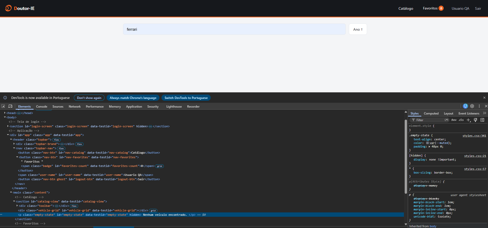
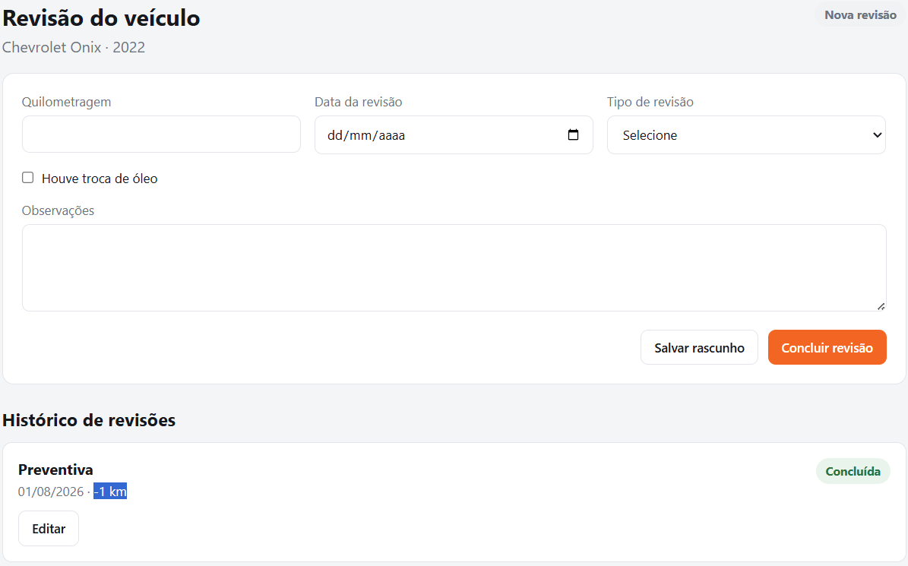
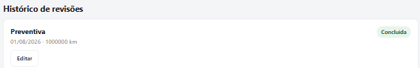
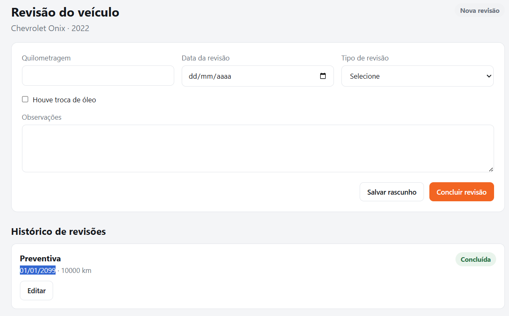
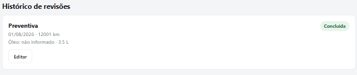
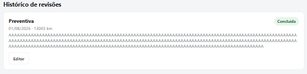
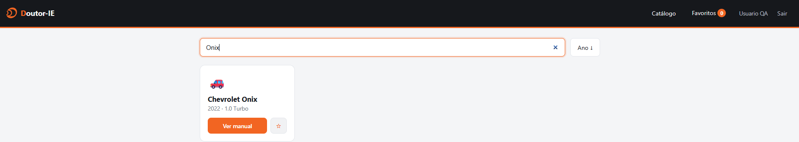
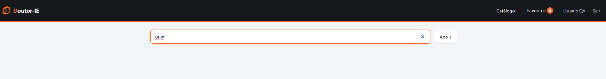

### [BUG-01] Mensagem de “Nenhum veículo encontrado” não é exibida na busca sem resultados

* **Severidade:** Média
* **Onde:** Tela de Catálogo / Componente de busca de veículos
* **Passos para reproduzir:**

1. Acessar a aplicação e realizar login com credenciais válidas.
2. Na tela de catálogo, localizar o campo de busca de veículos.
3. Digitar um termo que não corresponda a nenhum veículo cadastrado, como **“Ferrari”**.
4. Observar o comportamento da listagem.

* **Resultado esperado:**
  Os cards dos veículos devem desaparecer e a mensagem **“Nenhum veículo encontrado.”** deve ser exibida ao usuário, informando que a busca não retornou resultados.

* **Resultado obtido:**
  Os cards dos veículos desaparecem, porém nenhuma mensagem é apresentada. A área do catálogo permanece completamente vazia. Ao inspecionar o DOM pelo DevTools, o elemento `data-testid="empty-state"` contendo a mensagem **“Nenhum veículo encontrado.”** permanece com o atributo `hidden`.

* **Evidência:**
  Print da tela após a pesquisa por **“Ferrari”**, demonstrando o catálogo vazio sem mensagem de feedback. Evidência adicional pelo DevTools mostrando o elemento `empty-state` ainda com o atributo `hidden`. O comportamento também pode ser reproduzido pelo teste automatizado de busca sem resultados no Playwright.
  

<!-- ========== -->

### [BUG-02] Sistema permite concluir revisão com quilometragem fora dos limites permitidos

* **Severidade:** Alta
* **Onde:** Tela de Revisão / Campo Quilometragem / RN01
* **Passos para reproduzir:**

1. Realizar login com credenciais válidas.
2. Abrir o manual de um veículo.
3. Clicar em **“Realizar revisão”**.
4. Informar no campo **Quilometragem** um valor fora da faixa permitida, como `-1` ou `1000000`.
5. Preencher uma data válida.
6. Selecionar um tipo de revisão válido.
7. Clicar em **“Concluir revisão”**.

* **Resultado esperado:**
  O sistema deve impedir a conclusão da revisão e apresentar uma mensagem de validação, pois a RN01 determina que a quilometragem deve ser um número inteiro entre `0` e `999999`.

* **Resultado obtido:**
  O sistema permite concluir e registrar revisões com valores fora dos limites definidos pela RN01. Foram reproduzidos os seguintes casos:

  * `-1 km` — revisão concluída.
  * `1000000 km` — revisão concluída.

Nenhuma mensagem de validação é apresentada nesses casos.

* **Evidência:**
  Prints do histórico de revisões mostrando registros com status **“Concluída”** contendo `-1 km` e `1000000 km`. Testes automatizados no Playwright também evidenciam o desvio ao esperar a exibição da validação e encontrar o elemento `revision-error` oculto.

<!-- ========== -->

### [BUG-03] Sistema permite concluir revisão com data futura

* **Severidade:** Alta
* **Onde:** Tela de Revisão / Campo Data da revisão / RN02
* **Passos para reproduzir:**

1. Realizar login com credenciais válidas.
2. Abrir o manual de um veículo.
3. Clicar em **“Realizar revisão”**.
4. Informar uma quilometragem válida, como `10000`.
5. Informar uma data futura, como `01/01/2099`.
6. Selecionar um tipo de revisão válido, como **Preventiva**.
7. Clicar em **“Concluir revisão”**.

* **Resultado esperado:**
  O sistema deve impedir a conclusão da revisão e apresentar uma mensagem de validação informando que a data da revisão não pode estar no futuro.

* **Resultado obtido:**
  A revisão é concluída normalmente, sem mensagem de erro, e é adicionada ao histórico com a data futura `01/01/2099`.

* **Evidência:**
  Teste automatizado no Playwright falhando ao esperar o elemento `revision-error` visível e print do histórico exibindo uma revisão preventiva concluída com a data `01/01/2099`.

<!-- ========== -->

### [BUG-04] Sistema permite concluir revisão com dados obrigatórios da troca de óleo ausentes

* **Severidade:** Alta
* **Onde:** Tela de Revisão / Campos de troca de óleo / RN04
* **Passos para reproduzir:**

1. Realizar login com credenciais válidas.
2. Abrir o manual de um veículo.
3. Clicar em **“Realizar revisão”**.
4. Preencher quilometragem, data e tipo da revisão com valores válidos.
5. Marcar a opção **“Houve troca de óleo”**.
6. Deixar o campo **“Tipo do óleo”** vazio e informar uma quantidade válida.
7. Clicar em **“Concluir revisão”**.
8. Repetir o teste informando o tipo do óleo e deixando a quantidade vazia.

* **Resultado esperado:**
  O sistema deve impedir a conclusão da revisão sempre que a opção **“Houve troca de óleo”** estiver marcada e o tipo ou a quantidade do óleo não estiverem preenchidos.

* **Resultado obtido:**
  O sistema conclui e registra a revisão mesmo com dados obrigatórios da troca de óleo ausentes. Foram reproduzidos os seguintes cenários:

  * Revisão concluída com quantidade de `3.5 L` e tipo do óleo não informado.
  * Revisão concluída com tipo `5W-30` e quantidade do óleo não informada.

* **Evidência:**
  Prints do histórico exibindo as revisões `12001 km` e `12002 km` com status **“Concluída”**, mesmo com dados obrigatórios da troca de óleo ausentes. Os testes automatizados no Playwright também falham ao esperar a exibição da mensagem de validação.
  

<!-- ========== -->

### [BUG-05] Sistema permite concluir revisão com observações acima de 300 caracteres

* **Severidade:** Média
* **Onde:** Tela de Revisão / Campo Observações / RN05
* **Passos para reproduzir:**

1. Realizar login com credenciais válidas.
2. Abrir o manual de um veículo.
3. Clicar em **“Realizar revisão”**.
4. Preencher quilometragem, data e tipo da revisão com valores válidos.
5. Informar no campo **“Observações”** um texto com mais de 300 caracteres, como um texto contendo 301 caracteres.
6. Clicar em **“Concluir revisão”**.

* **Resultado esperado:**
  O sistema deve impedir a conclusão da revisão e apresentar uma mensagem de validação informando que o campo **“Observações”** permite no máximo 300 caracteres. O conteúdo não deve ser truncado silenciosamente.

* **Resultado obtido:**
  O sistema não apresenta nenhuma mensagem de validação e permite concluir a revisão mesmo após o campo receber 301 caracteres. A revisão é registrada no histórico com status **“Concluída”** e o conteúdo das observações é exibido.

* **Evidência:**
  Print do histórico exibindo a revisão `13003 km` com status **“Concluída”** e o texto informado no campo Observações. O teste automatizado no Playwright também falha ao esperar a exibição do elemento `revision-error` após o envio de 301 caracteres.

<!-- ========== -->

### [BUG-06] Revisão concluída pode ser editada e retornar ao estado de rascunho

* **Severidade:** Alta
* **Onde:** Tela de Revisão / Histórico de revisões / RN06
* **Passos para reproduzir:**

1. Realizar login com credenciais válidas.
2. Abrir o manual de um veículo.
3. Clicar em **“Realizar revisão”**.
4. Preencher todos os campos obrigatórios com valores válidos.
5. Clicar em **“Concluir revisão”**.
6. Localizar a revisão com status **“Concluída”** no histórico.
7. Clicar no botão **“Editar”**.
8. Alterar algum dado da revisão, como a quilometragem.
9. Clicar em **“Salvar rascunho”**.

* **Resultado esperado:**
  Uma revisão concluída não deve permitir edição e não pode retornar ao estado de rascunho. O botão **“Editar”** não deve estar disponível para revisões com status **“Concluída”**.

* **Resultado obtido:**
  A revisão concluída exibe o botão **“Editar”**. Ao clicar nele, os dados da revisão são carregados novamente no formulário, podem ser alterados e a revisão pode ser salva novamente com status **“Rascunho”**.

* **Evidência:**
  Teste automatizado no Playwright identificando `1` botão **“Editar”** em uma revisão concluída, quando o esperado era `0`. Em teste adicional, a revisão concluída `15002 km` foi aberta para edição, teve a quilometragem alterada para `15003 km` e foi salva novamente com status **“Rascunho”**.

<!-- API -->

### [BUG-07] Capacidade do tanque exibida na UI diverge do valor retornado pela API

* **Severidade:** Alta
* **Onde:** Tela de Manual do Veículo / Especificações técnicas / Campo Capacidade do tanque
* **Passos para reproduzir:**

1. Realizar login com credenciais válidas.
2. Acessar o manual do **Chevrolet Onix**.
3. Consultar a capacidade do tanque exibida na seção de fluidos.
4. Consultar o endpoint `GET /api/vehicles/1/specs`.
5. Comparar o valor retornado pela API com o valor apresentado na interface.

* **Resultado esperado:**
  A capacidade do tanque exibida na interface deve ser consistente com o valor retornado pela API. Para o Chevrolet Onix, a API retorna `fuelTankLiters: 44`, portanto a UI deve apresentar `44 L`.

* **Resultado obtido:**
  A API retorna `44 L`, porém a interface exibe `4,4 L`, apresentando uma capacidade dez vezes menor que o valor informado pelo backend.

* **Evidência:**
  Teste automatizado no Playwright comparando API e UI falha com o seguinte resultado: valor esperado `44 L` e valor recebido `4,4 L`. Evidência adicional disponível na tela do manual do Chevrolet Onix e na resposta do endpoint `/api/vehicles/1/specs`.

<!-- TESTES MANUAIS -->

### [BUG-08] Busca de veículos diferencia letras maiúsculas e minúsculas

* **Severidade:** Média
* **Onde:** Tela de Catálogo / Componente de busca de veículos
* **Passos para reproduzir:**

1. Realizar login com credenciais válidas.
2. Na tela de catálogo, localizar o campo de busca.
3. Pesquisar pelo modelo utilizando a capitalização exibida no catálogo, por exemplo `Onix`.
4. Confirmar que o veículo é encontrado.
5. Repetir a busca utilizando `onix`, `ONIX` ou `OnIx`.
6. Comparar os resultados apresentados.

* **Resultado esperado:**
  A busca deve encontrar o mesmo veículo independentemente do uso de letras maiúsculas ou minúsculas, considerando `Onix`, `onix`, `ONIX` e `OnIx` como termos equivalentes.

* **Resultado obtido:**
  A busca é case sensitive e o resultado depende da capitalização utilizada no termo pesquisado. Variações com letras maiúsculas e minúsculas deixam de retornar o veículo esperado.

* **Evidência:**
  Prints das buscas realizadas com diferentes combinações de letras maiúsculas e minúsculas, demonstrando a diferença nos resultados apresentados.

<!-- ========== -->

### [BUG-09] Ordenação crescente por ano não é aplicada corretamente

* **Severidade:** Média
* **Onde:** Tela de Catálogo / Componente de ordenação por ano
* **Passos para reproduzir:**

1. Realizar login com credenciais válidas.
2. Acessar a tela de catálogo de veículos.
3. Utilizar o botão de ordenação por ano.
4. Validar a ordenação do maior ano para o menor.
5. Clicar novamente no botão para alterar a ordenação para o menor ano até o maior.
6. Observar a ordem dos veículos apresentados.

* **Resultado esperado:**
  Ao alternar o botão de ordenação, a listagem deve ser reorganizada corretamente nos dois sentidos: do maior ano para o menor e do menor ano para o maior.

* **Resultado obtido:**
  A ordenação do maior ano para o menor funciona corretamente. Porém, ao alterar para a ordenação do menor ano para o maior, os veículos não são reorganizados conforme esperado.

* **Evidência:**
  Teste manual realizado no catálogo, alternando o botão de ordenação por ano e comparando a sequência dos veículos apresentada em cada estado.

<!-- ========== -->

### [BUG-10] Contador de favoritos não é decrementado ao desfavoritar um veículo

* **Severidade:** Média
* **Onde:** Tela de Catálogo / Componente de Favoritos / Contador de favoritos
* **Passos para reproduzir:**

1. Realizar login com credenciais válidas.
2. Localizar o veículo **Chevrolet Onix** no catálogo.
3. Favoritar o veículo.
4. Verificar que o contador de favoritos é atualizado para `1`.
5. Desfavoritar o mesmo veículo.
6. Observar o contador de favoritos.

* **Resultado esperado:**
  Ao desfavoritar o único veículo favoritado, o contador deve ser atualizado de `1` para `0`.

* **Resultado obtido:**
  O veículo é desfavoritado, porém o contador permanece exibindo `1`.

* **Evidência:**
  Teste manual realizado no catálogo, favoritando e em seguida desfavoritando o Chevrolet Onix, com o contador permanecendo em `1` após a remoção do favorito.
