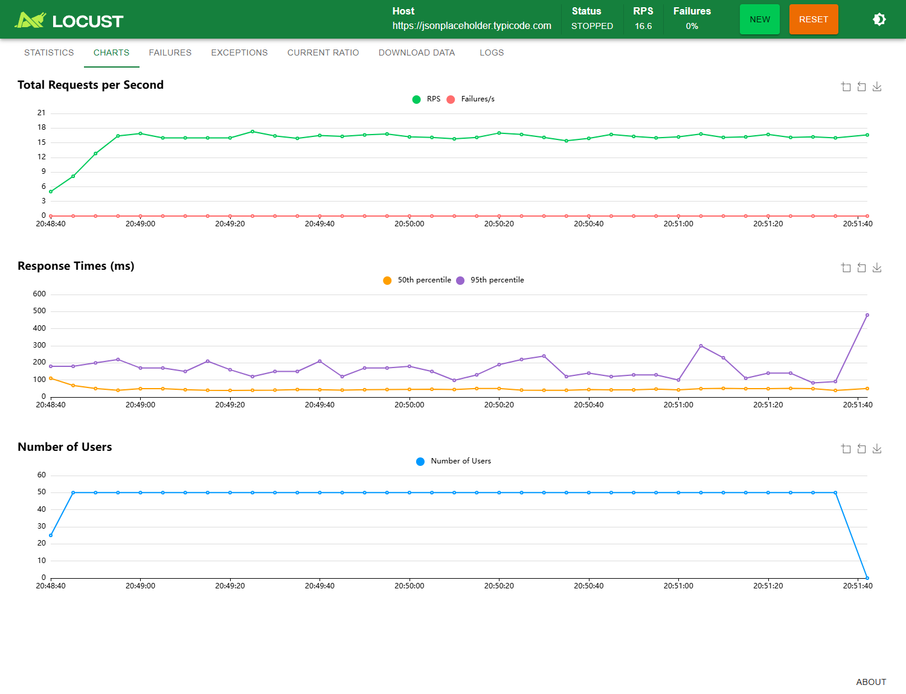

Teste de Stress em E-sports

Qualidade e Teste de Software
Professor: MSc. Hugo Menezes Barra
Data da execução: 06/11/2026

Aluno: João Victor Bagatim

GitHub: <link href="https://github.com/joaobagatim/SENAI/tree/main/QA/Trabalho-TesteCargaStress" color="blue">joaobagatim/SENAI — QA/Trabalho-TesteCargaStress</link>

1. Teste de carga e teste de estresse

A situação da RiotForge é usada para o planejamento teórico. A prática consulta perfis em uma API pública, conforme o enunciado.

01. O RNF-PERF-01 deve ser avaliado com teste de carga, pois define uma capacidade esperada de operação.

02. A equipe de QA deve aumentar a carga gradualmente até atingir 10.000 requisições simultâneas.

03. Uma rampa possível é acrescentar 1.000 requisições concorrentes por etapa, mantendo cada patamar para medir o comportamento.

04. Ao chegar à carga prevista, a equipe deve sustentá-la e verificar se a latência permanece inferior a 800 ms.

05. Devem ser registrados os tempos de resposta, os percentis, o máximo, a vazão e as falhas em cada etapa.

06. Como o requisito não define um percentil, a média sozinha não comprova seu cumprimento; a interpretação deve ser alinhada com o PO.

07. Já o RNF-RES-02 exige teste de estresse, ultrapassando a capacidade normal em ambiente controlado.

08. Nesse teste, a rampa continua além do limite esperado até provocar, de forma monitorada, o esgotamento das conexões com o banco.

09. O QA verifica se a API rejeita o excesso de forma controlada, por exemplo com HTTP 503 e uma mensagem clara.

10. Depois, a equipe reduz a carga até o nível normal e inicia a medição do tempo de recuperação.

11. O fluxo deve voltar ao normal em menos de 60 segundos, sem reinício manual e sem deixar o serviço travado.

12. Portanto, o primeiro teste avalia desempenho na capacidade prevista; o segundo avalia falha controlada e recuperação após a sobrecarga.


---


2. Ponto de colapso e métricas

O ponto de colapso é o nível de carga em que o sistema perde a capacidade de atender as requisições de maneira aceitável e sustentada. A identificação deve combinar métricas ao longo do tempo: um pico isolado de latência não comprova colapso.

Latência: tempo entre enviar a requisição e receber a resposta. O aumento persistente do p95/p99 e dos tempos máximos indica filas e dificuldade de atendimento. O p95 é o tempo em que aproximadamente 95% das requisições terminam. Ultrapassar 800 ms representa uma violação do requisito de desempenho, mas, isoladamente, não significa colapso.

Vazão (throughput): quantidade de requisições atendidas por segundo. Se a demanda continua aumentando e a vazão para de crescer ou cai, há sinal de saturação. Esse comportamento deve ser analisado junto das falhas e da latência.

Taxa de erro: percentual de requisições com falha: falhas ÷ total × 100. Muitos timeouts ou erros HTTP 500/504 mostram perda de atendimento. Respostas 503 controladas também contam como falha no cliente, mas podem demonstrar a proteção esperada no RNF-RES-02.

Recursos e conexões: CPU ou memória saturadas, pool de conexões esgotado e filas crescentes ajudam a localizar a causa. Esses dados exigem acesso ao servidor; não estão disponíveis no teste da API pública.

3. Configuração da prática

Foi usado o Locust 2.43.1 com Python 3.11.9 no Windows. Cada usuário executou GET em https://jsonplaceholder.typicode.com/users e aguardou um intervalo aleatório entre 2 e 4 segundos antes de repetir a tarefa.

O teste principal usou 50 usuários, entrada de 5 por segundo e duração total de 180 segundos. A rampa durou aproximadamente 10 segundos e está incluída nos 3 minutos. Foram executados outros cinco cenários, em sequência, com estatísticas reiniciadas entre eles.

As execuções foram iniciadas pela interface HTTP do próprio painel Locust, acompanhadas na aba Charts e encerradas pelo tempo configurado. As capturas são reais, e as estatísticas foram exportadas do Locust para CSV, JSON e HTML.

Usuários virtuais não equivalem a requisições simultâneas: parte deles fica esperando entre consultas. Os cenários práticos seguem a configuração de estresse solicitada, mas só demonstram um ponto de colapso se houver saturação observada. Nenhum teste de 10.000 requisições foi executado na API pública.


---


4. Código e comparação dos seis testes

```python
"""Teste de consulta ao perfil dos jogadores, conforme o enunciado."""

from locust import HttpUser, between, task


class Jogador(HttpUser):
    host = "https://jsonplaceholder.typicode.com"
    wait_time = between(2, 4)

    @task
    def consultar_jogadores(self):
        self.client.get("/users")
```


Teste | Usuários | Entrada/s | Tempo (s) | Requisições | Erros (%) | Média (ms) | p95 (ms) | Req./s
T1 | 50 | 5 | 180 | 2879 | 0,00 | 60,98 | 160 | 16,02
T2 | 10 | 2 | 45 | 143 | 0,00 | 54,03 | 100 | 3,20
T3 | 25 | 5 | 60 | 481 | 0,42 | 72,34 | 200 | 8,01
T4 | 40 | 5 | 75 | 946 | 0,00 | 56,43 | 150 | 12,62
T5 | 60 | 5 | 90 | 1669 | 0,00 | 49,73 | 110 | 18,56
T6 | 75 | 5 | 120 | 2813 | 0,00 | 53,76 | 130 | 23,44


A média e o p95 representam o teste completo, incluindo a rampa. A vazão é a média total informada pelo Locust. Os percentis são aproximações calculadas por agrupamento dos tempos de resposta.

Comparando os extremos, T2 (10 usuários) registrou 3,20 req./s e média de 54,03 ms; T6 (75 usuários) registrou 23,44 req./s e média de 53,76 ms. A mudança de vazão deve ser interpretada junto da latência e das falhas, pois cada usuário também passa de 2 a 4 segundos em espera.

A menor latência média ocorreu no T5 (49,73 ms) e a maior no T3 (72,34 ms). Como os tempos de execução são diferentes e cada cenário foi executado uma vez, a comparação é descritiva e não isola o efeito da quantidade de usuários de variações da rede e do serviço.

As capturas dos seis testes estão na pasta evidencias. Os arquivos da pasta resultados permitem conferir contagens, erros, tempos máximos e distribuições de resposta.

T3: 2 ocorrência(s) de RemoteDisconnected(&#x27;Remote end closed connection without response&#x27;). A falha foi observada no cliente; sem logs internos, não é possível atribuí-la ao servidor, à rede ou a um intermediário.


---


5. Evidência visual — teste de 3 minutos



Figura 1. Captura da aba Charts do Locust após o término do T1, com 50 usuários, entrada de 5 usuários/s e duração de 180 segundos. A redução de usuários ao final corresponde ao encerramento programado.

O teste principal registrou 2879 requisições, 0 falhas, latência média de 60,98 ms, p95 de 160 ms e máximo de 860,00 ms. A vazão média foi de 16,02 req./s.

O gráfico de requisições por segundo mostra a vazão e as falhas por segundo. O gráfico de tempos de resposta permite observar oscilações da mediana e do p95. O gráfico de usuários mostra a rampa até 50 usuários e o encerramento. A leitura deve seguir as legendas da versão instalada do Locust, pois as cores podem variar.


---


6. Análise de engenharia

01. Nos seis cenários foram realizadas 8931 requisições e registradas 2 falhas pelo Locust.

02. No teste principal, a taxa de erro foi de 0,00% e a latência média ficou em 60,98 ms.

03. O p95 do teste principal foi de 160 ms, enquanto o máximo chegou a 860,00 ms.

04. Assim, o teste principal apresentou 0% de erro; isso demonstra sucesso das requisições segundo a classificação HTTP do Locust.

05. O maior p95 entre os seis cenários foi de 200 ms; o valor ajuda a avaliar a latência da maioria das respostas.

06. No teste principal, os dados indicam atendimento estável e desempenho favorável na consulta de perfis.

07. Para o T1, a API passaria em uma avaliação limitada de eficiência de desempenho que adotasse 0% de erro e p95 inferior a 800 ms.

08. Considerando todos os cenários, a API não manteve 0% de erro; as falhas registradas impedem afirmar estabilidade total.

09. Esse critério prático não substitui o RNF-PERF-01: o enunciado exige menos de 800 ms para até 10.000 requisições simultâneas.

10. Além de a carga ser menor, a prática usa GET /users, enquanto o requisito teórico trata da atualização do placar ao vivo.

11. Não houve acesso à CPU, à memória nem ao banco da API pública; a observação se limita ao comportamento visto pelo cliente.

12. Uma resposta rápida pode envolver cache, e variações da rede também afetam a latência medida; não foi identificada a arquitetura interna do fornecedor.

13. As métricas devem ser observadas em conjunto para distinguir oscilações isoladas de um ponto de colapso sustentado.

14. O RNF-RES-02 não foi validado, pois não houve indução controlada de esgotamento do banco seguida de medição da recuperação.

15. Uma avaliação completa da RiotForge exige ambiente próprio, carga compatível com o requisito e testes de recuperação após a sobrecarga.

Referências e entrega

1. Material de aula fornecido: Aula 11 - Teste de Stress e Requisitos Não Funcionais.pdf.
2. Enunciado fornecido: Trabalho - Teste de Stress (Qualidade e Teste de Software) (1).pdf.
3. Locust: <link href="https://docs.locust.io/en/stable/writing-a-locustfile.html" color="blue">Writing a locustfile</link> e <link href="https://docs.locust.io/en/stable/running-without-web-ui.html" color="blue">Running without the web UI</link>.

O endereço do código no GitHub consta na identificação. Este relatório deve ser enviado no AVA.